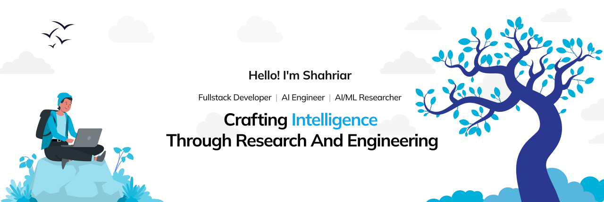
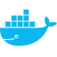

  
  
  
  

## About

I'm an AI Engineer with experience in **building AI-powered SaaS products** and research interests in Agentic AI, Computer Vision, Multimodal AI, and Information Retrieval. Earned **7 academic honours** at the University of Asia Pacific and won the **Best Group Award at Nippon AI Dojo 2026**, a programme funded by Japan’s Ministry of Economy, Trade and Industry (METI).

## Technical Skills

   <b>Frontend & Backend</b>
     
   <picture>
      
   </picture>
   <picture>
      
   </picture>
   <picture>
      
   </picture>
   <picture>
      <source media="(prefers-color-scheme: light)" srcset="assets/icons/reactjs-light.svg?v=1">
      <source media="(prefers-color-scheme: dark)" srcset="assets/icons/reactjs-dark.svg?v=1">
      
   </picture>
   <picture>
      <source media="(prefers-color-scheme: light)" srcset="assets/icons/nextjs-light.svg?v=1">
      <source media="(prefers-color-scheme: dark)" srcset="assets/icons/nextjs-dark.svg?v=1">
      
   </picture>
   <picture>
      <source media="(prefers-color-scheme: light)" srcset="assets/icons/svelte-light.svg?v=1">
      <source media="(prefers-color-scheme: dark)" srcset="assets/icons/svelte-dark.svg?v=1">
      
   </picture>
   <picture>
      <source media="(prefers-color-scheme: light)" srcset="assets/icons/astro-light.svg?v=1">
      <source media="(prefers-color-scheme: dark)" srcset="assets/icons/astro-dark.svg?v=1">
      
   </picture>
   <picture>
      <source media="(prefers-color-scheme: light)" srcset="assets/icons/flask-light.svg?v=1">
      <source media="(prefers-color-scheme: dark)" srcset="assets/icons/flask-dark.svg?v=1">
      
   </picture>
   <picture>
      <source media="(prefers-color-scheme: light)" srcset="assets/icons/django-light.svg?v=1">
      <source media="(prefers-color-scheme: dark)" srcset="assets/icons/django-dark.svg?v=1">
      
   </picture>
   <picture>
      <source media="(prefers-color-scheme: light)" srcset="assets/icons/streamlit-light.svg?v=1">
      <source media="(prefers-color-scheme: dark)" srcset="assets/icons/streamlit-dark.svg?v=1">
      
   </picture>
   <picture>
      <source media="(prefers-color-scheme: light)" srcset="assets/icons/tailwindcss-light.svg?v=1">
      <source media="(prefers-color-scheme: dark)" srcset="assets/icons/tailwindcss-dark.svg?v=1">
      
   </picture>
   <picture>
      <source media="(prefers-color-scheme: light)" srcset="assets/icons/zustand-light.svg?v=1">
      <source media="(prefers-color-scheme: dark)" srcset="assets/icons/zustand-dark.svg?v=1">
      
   </picture>
    
   <picture>
      <source media="(prefers-color-scheme: light)" srcset="assets/icons/nodejs-light.svg?v=1">
      <source media="(prefers-color-scheme: dark)" srcset="assets/icons/nodejs-dark.svg?v=1">
      
   </picture>
   <picture>
      <source media="(prefers-color-scheme: light)" srcset="assets/icons/expressjs-light.svg?v=1">
      <source media="(prefers-color-scheme: dark)" srcset="assets/icons/expressjs-dark.svg?v=1">
      
   </picture>
   <picture>
      <source media="(prefers-color-scheme: light)" srcset="assets/icons/graphql-light.svg?v=1">
      <source media="(prefers-color-scheme: dark)" srcset="assets/icons/graphql-dark.svg?v=1">
      
   </picture>
   <picture>
      <source media="(prefers-color-scheme: light)" srcset="assets/icons/tauri-light.svg?v=1">
      <source media="(prefers-color-scheme: dark)" srcset="assets/icons/tauri-dark.svg?v=1">
      
   </picture>
   <picture>
      <source media="(prefers-color-scheme: light)" srcset="assets/icons/mysql-light.svg?v=1">
      <source media="(prefers-color-scheme: dark)" srcset="assets/icons/mysql-dark.svg?v=1">
      
   </picture>
   <picture>
      <source media="(prefers-color-scheme: light)" srcset="assets/icons/mongodb-light.svg?v=1">
      <source media="(prefers-color-scheme: dark)" srcset="assets/icons/mongodb-dark.svg?v=1">
      
   </picture>
   <picture>
      <source media="(prefers-color-scheme: light)" srcset="assets/icons/postgres-light.svg?v=1">
      <source media="(prefers-color-scheme: dark)" srcset="assets/icons/postgres-dark.svg?v=1">
      
   </picture>
   <picture>
      <source media="(prefers-color-scheme: light)" srcset="assets/icons/supabase-light.svg?v=1">
      <source media="(prefers-color-scheme: dark)" srcset="assets/icons/supabase-dark.svg?v=1">
      
   </picture>
   <picture>
      <source media="(prefers-color-scheme: light)" srcset="assets/icons/convex-light.svg?v=1">
      <source media="(prefers-color-scheme: dark)" srcset="assets/icons/convex-dark.svg?v=1">
      
   </picture>
   <picture>
      <source media="(prefers-color-scheme: light)" srcset="assets/icons/redis-light.svg?v=1">
      <source media="(prefers-color-scheme: dark)" srcset="assets/icons/redis-dark.svg?v=1">
      
   </picture>
   <picture>
      <source media="(prefers-color-scheme: light)" srcset="assets/icons/fastapi-light.svg?v=1">
      <source media="(prefers-color-scheme: dark)" srcset="assets/icons/fastapi-dark.svg?v=1">
      
   </picture>
   <picture>
      
   </picture>

 

   <b>AI/ML & Research</b>
     
   <picture>
      <source media="(prefers-color-scheme: light)" srcset="assets/icons/python-light.svg?v=1">
      <source media="(prefers-color-scheme: dark)" srcset="assets/icons/python-dark.svg?v=1">
      
   </picture>
   <picture>
      <source media="(prefers-color-scheme: light)" srcset="assets/icons/sklearn-light.svg?v=1">
      <source media="(prefers-color-scheme: dark)" srcset="assets/icons/sklearn-dark.svg?v=1">
      
   </picture>
   <picture>
      <source media="(prefers-color-scheme: light)" srcset="assets/icons/pytorch-light.svg?v=1">
      <source media="(prefers-color-scheme: dark)" srcset="assets/icons/pytorch-dark.svg?v=1">
      
   </picture>
   <picture>
      <source media="(prefers-color-scheme: light)" srcset="assets/icons/opencv-light.svg?v=1">
      <source media="(prefers-color-scheme: dark)" srcset="assets/icons/opencv-dark.svg?v=1">
      
   </picture>
   <picture>
      <source media="(prefers-color-scheme: light)" srcset="assets/icons/gradio-light.svg?v=1">
      <source media="(prefers-color-scheme: dark)" srcset="assets/icons/gradio-dark.svg?v=1">
      
   </picture>
   <picture>
      <source media="(prefers-color-scheme: light)" srcset="assets/icons/langchain-light.svg?v=1">
      <source media="(prefers-color-scheme: dark)" srcset="assets/icons/langchain-dark.svg?v=1">
      
   </picture>
   <picture>
      <source media="(prefers-color-scheme: light)" srcset="assets/icons/llamaindex-light.svg?v=1">
      <source media="(prefers-color-scheme: dark)" srcset="assets/icons/llamaindex-dark.svg?v=1">
      
   </picture>
   <picture>
      <source media="(prefers-color-scheme: light)" srcset="assets/icons/ollama-light.svg?v=1">
      <source media="(prefers-color-scheme: dark)" srcset="assets/icons/ollama-dark.svg?v=1">
      
   </picture>
   <picture>
      <source media="(prefers-color-scheme: light)" srcset="assets/icons/vllm-light.svg?v=1">
      <source media="(prefers-color-scheme: dark)" srcset="assets/icons/vllm-dark.svg?v=1">
      
   </picture>
   <picture>
      <source media="(prefers-color-scheme: light)" srcset="assets/icons/neo4j-light.svg?v=1">
      <source media="(prefers-color-scheme: dark)" srcset="assets/icons/neo4j-dark.svg?v=1">
      
   </picture>
   <picture>
      <source media="(prefers-color-scheme: light)" srcset="assets/icons/chromadb-light.svg?v=1">
      <source media="(prefers-color-scheme: dark)" srcset="assets/icons/chromadb-dark.svg?v=1">
      
   </picture>
   <!--   -->
   <picture>
      <source media="(prefers-color-scheme: light)" srcset="assets/icons/pandas-light.svg?v=1">
      <source media="(prefers-color-scheme: dark)" srcset="assets/icons/pandas-dark.svg?v=1">
      
   </picture>
   <picture>
      <source media="(prefers-color-scheme: light)" srcset="assets/icons/numpy-light.svg?v=1">
      <source media="(prefers-color-scheme: dark)" srcset="assets/icons/numpy-dark.svg?v=1">
      
   </picture>
   <picture>
      <source media="(prefers-color-scheme: light)" srcset="assets/icons/matplotlib-light.svg?v=1">
      <source media="(prefers-color-scheme: dark)" srcset="assets/icons/matplotlib-dark.svg?v=1">
      
   </picture>

 

   <b>Other Tools</b>
     
   <picture>
      
   </picture>
   &nbsp;
   <picture>
      <source media="(prefers-color-scheme: light)" srcset="assets/icons/mlflow-light.svg?v=1" />
      <source media="(prefers-color-scheme: dark)" srcset="assets/icons/mlflow-dark.svg?v=1" />
      
   </picture>
   &nbsp;
   <picture>
      <source media="(prefers-color-scheme: light)" srcset="assets/icons/figma-light.svg?v=1" />
      <source media="(prefers-color-scheme: dark)" srcset="assets/icons/figma-dark.svg?v=1" />
      
   </picture>

## Github Stats

   <picture>
      <source
         media="(prefers-color-scheme: light)"
         srcset="https://github-stats-extended.vercel.app/api/top-langs?username=Arefin40&layout=compact&langs_count=4&hide_values=true&theme=light_github&title_color=0FA4E9&border_color=E4E2E2"
      />
      <source
         media="(prefers-color-scheme: dark)"
         srcset="https://github-stats-extended.vercel.app/api/top-langs?username=Arefin40&layout=compact&langs_count=4&hide_values=true&theme=dark_github&title_color=0FA4E9&border_color=30363D"
      />
      
   </picture>
   <picture>
      <source
         media="(prefers-color-scheme: light)"
         srcset="https://github-readme-streak-stats.herokuapp.com?user=Arefin40&short_numbers=true&fire=0FA4E9&currStreakLabel=0FA4E9&sideNums=0FA4E9&ring=008AAA&currStreakNum=0FA4E9&sideLabels=008AAA&background=FFFFFF&stroke=E4E2E2&text=000000&border=E4E2E2"
      />
      <source
         media="(prefers-color-scheme: dark)"
         srcset="https://github-readme-streak-stats.herokuapp.com?user=Arefin40&short_numbers=true&fire=0FA4E9&currStreakLabel=0FA4E9&sideNums=0FA4E9&ring=008AAA&currStreakNum=0FA4E9&sideLabels=008AAA&theme=dark&background=0D1116&stroke=30363D&border=30363D"
      />
      
   </picture>

